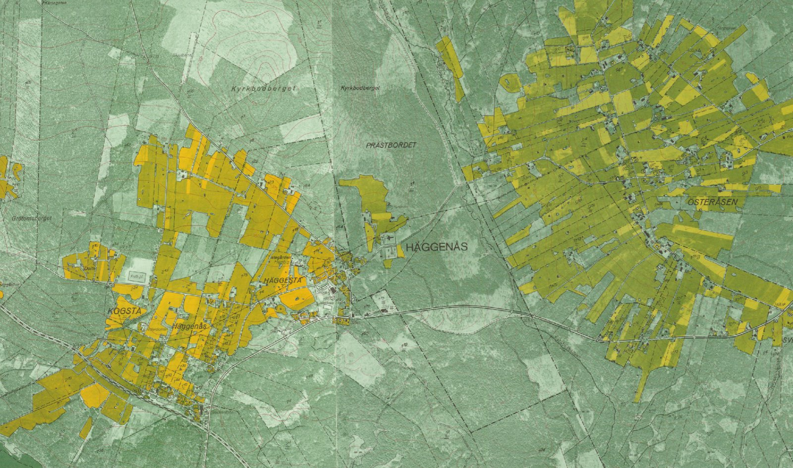

# LM Ekonomiska kartan – alla skalor



*Två kartblad från ekonomiska kartan vid Häggenås, inpassade automatiskt och ihopfogade. Skarven går lodrätt mitt i bilden, och vägar och ägogränser fortsätter rakt över den. Färgskillnaden kommer från olika tryck av bladen.*

Rita eller välj ett område i QGIS och få Lantmäteriets ekonomiska karta över det som georefererade kartblad, i 1:10 000 där den serien finns och i 1:20 000 där den inte gör det. Du behöver inte veta vilken skala eller vilken fil som gäller var.

## ⬇️ [Ladda ner senaste versionen](https://github.com/kaje-home/lm-ekonomiska-kartan-alla-skalor/releases/latest/download/lm_ekokarta.zip)

En zip-fil som installeras i QGIS, se Snabbstart här nedanför.

## Snabbstart

1. **Installera.** Ladda ner zip-filen ovan. Öppna QGIS och välj **Insticksprogram → Hantera och installera insticksprogram…**, fliken **Installera från ZIP**. Peka på filen och tryck *Installera insticksprogram*.
2. **Öppna.** Välj **Insticksprogram → Ekonomiska kartan → Hämta ekonomiska kartan…**, eller knappen med kartbladet i verktygsfältet.
3. **Område.** Välj *Kartfönstrets utbredning*, ett *Polygonlager* (gärna bara markerade objekt), *Rita i kartan* eller *Rutor ur ett rutnät*: tryck *Bygg bladrutnät* och sedan *Markera i kartan…* för att markera de blad du vill ha, eller skapa ett fast rutnät (se [Bladrutnät och fast rutnät](#bladrutnät-och-fast-rutnät)).
4. **Utmapp.** Välj en tom mapp **utanför OneDrive**, till exempel `C:\Ekokartan\Uttag1`.
5. **Hämta.** När det är klart ligger kartan och ett bladlager i en grupp överst i lagerlistan.

Ingen inloggning behövs. Kräver QGIS 3.40 eller nyare (QGIS 4 går också). Provat i QGIS 3.44 och 4.2. Pluginet är experimentellt i version 0.2.

## Vad skiljer det här pluginet från andra

Det finns redan ett plugin, [Geodata: Ekonomiska kartan (Lantmäteriet)](https://github.com/matself/qgis-plugin-ekonomiska-kartan), som söker och laddar 1:10 000-bladen med Lantmäteriets världsfil. Det här gör mer än så:

| | Det här pluginet | 1:10 000-pluginet |
|---|---|---|
| 1:10 000 | ja, med granskad världsfil | ja |
| **1:20 000 (Norrlands inland, ~1 050 blad)** | **ja, georefererat automatiskt** | nej – serien saknar georeferens |
| Väljer skala efter området | ja | – |
| Klippt per blad, genomskinliga kanter | ja (alfaband) | nej |
| Omprojicerat till SWEREF 99 TM (eller valfritt) | ja | nej (RT 90) |
| VRT över hela området | ja | nej |
| Rapport per blad: källa, år, metod, lägesfel | ja | – |
| Bladrutnät för båda skalorna, med år och utgåvor | ja | nej |
| Fast rutnät och en GeoTIFF per ruta (brickor) | ja | nej |
| Processing-algoritm (batch, Model Designer) | ja | nej |

Över stora delar av Jämtland, Härjedalen och Norrbottens och Västerbottens inland finns ekonomiska kartan **bara** i 1:20 000. Lantmäteriet levererar de bladen som skanningar av hela det tryckta arket, med marginal och teckenförklaring, utan världsfil och utan koordinater. Det här pluginet räknar ut var bladet ligger ur bladnamnet och georefererar det mot kartans eget tryckta kilometerrutnät.

## Vad du får

I utmappen:

| Fil | Innehåll |
|---|---|
| `blad/19e6g_1971_10k.tif` | ett 1:10 000-blad, 1 m pixlar |
| `blad/J141-20F6-7g-h74_1974_20k.tif` | ett 1:20 000-blad, 2 m pixlar |
| `ekonomiska_kartan_1965-1977.vrt` | alla blad i en mosaik, i ordning efter utgåvevalet |
| `blad.gpkg` | bladrutorna med källa, år, metod och lägesfel per blad |
| `rapport.txt` | samma sak som text, en rad per blad |
| `brickor/N7082500_E520000.tif` | med *En GeoTIFF per ruta*: en bricka per ruta i rutnätet |

**Varje blad klipps mot sin ruta och får ett alfaband.** Utanför bladrutan är bilden genomskinlig, så det blir inga vita eller svarta kanter, och grannblad täcker inte varandra. I SWEREF 99 TM är rutnätet vridet knappt en grad (omkring 0,7°) mot RT 90, så kilarna finns på varje blad.

**Tryckåret står i varje filnamn**, i bladlagret och i rapporten. Bladen är från olika år, och **VRT:n blandar dem**: ett blad från 1965 kan ligga bredvid ett från 1977. Vill du veta vilket år du tittar på, tänd bladlagret. Lantmäteriet anger 1935–1978 för serien. Filnamnen på de öppna bladen bär tryckår från 1942 till 1988.

**Utgåva.** Omkring 330 blad i 1:10 000 finns från mer än ett år. Välj *Nyaste*, *Äldsta* eller *Alla utgåvor*. Med alla utgåvor får varje år en egen fil, och VRT:n visar den nyaste överst.

**Där båda skalorna finns gäller utgåvevalet även mellan dem.** Med *Nyaste* tas det yngsta bladet och med *Äldsta* det äldsta, oavsett skala; är bladen från samma år tas 1:10 000. Vägras bladet tas nästa. Ett blad som ingen ruta behöver hämtas inte. Ett 1:20 000-blad täcker fyra 1:10 000-rutor, så båda skalorna kan ändå hamna i samma mosaik. VRT:n ordnas efter samma regel, och rapporten skriver för varje ruta där skalorna överlappar vilket blad som ligger överst, vad som ligger under och vad som inte hämtades. Med *Båda serierna* hämtas alla blad i båda skalorna, ordnade efter samma regel.

**Delblad vid seriegränsen.** 80 av 1:20 000-bladen är bara delvis 1:20 000: en, två eller tre av bladets fyra rutor. Resten hör till 1:10 000-serien, fast kartan ofta är tryckt där också. Lantmäteriets index över 1:20 000-bladen (`Norrlands_Inland.shp`) anger vilka rutor det är. Ett sådant blad tar bara de rutorna och klipps mot dem. Rapporten och bladlagret säger det, och bladlagret ritar bara den delen. Går indexet inte att hämta klipps bladet som förut mot hela rutan, och loggen varnar.

**Resten av delbladet är reserv.** Den används bara i rutor som inget annat blad täcker, till exempel 19i8a, där det inte finns något 1:10 000-blad, eller där 1:10 000-bladets världsfil vägras. Den hamnar aldrig över ett 1:10 000-blad. Reserven klipps mot de rutorna, blir en egen fil (`…_20k_reserv.tif`) och ligger underst i VRT:n. I rapporten och bladlagret är den markerad som *reserv (utanför 1:20 000-delen enligt indexet)*, med fältet `reserv` = 1. Lägesfelet är bladets. I hela landet gäller det 11 rutor i läget *Automatiskt*. Med *Bara 1:20 000* blir de rutor av ett delblad som ligger i området alltid reserv, eftersom inga 1:10 000-blad hämtas.

**1:10 000-bladen från 1950-talet i Norrland kan vara nästan rena fotokartor**: flygbilden med lite tryckt kartinnehåll. Ett sådant blad kan vinna över ett yngre 1:20 000-blad med *Äldsta*, eller med *Nyaste* där inget yngre blad finns. Se tryckåret i bladlagret innan du klassar markslag (nedan).

**Samma utmapp igen.** Ett nytt uttag till samma utmapp skriver över det förra. Dialogen tar först bort lagren från det förra uttaget ur projektet. Blad som redan finns, gjorda ur samma källa med samma inställningar, används som de är. Är en fil ändå öppen, till exempel inläst i QGIS, får den nya filen ett reservnamn, som `blad.ny.gpkg`, och loggen säger det.

**Koordinatsystem.** Förvalt är SWEREF 99 TM (EPSG:3006). Väljer du RT 90 2,5 gon V (EPSG:3021), seriens eget system, omsamplas 1:10 000-bladen inte alls. Det är att föredra om du ska klassa pixlar efter färg (se nedan).

## Bladrutnät och fast rutnät

Två rutnät går att använda som område, med alla rutor eller bara de markerade. I dialogen heter valet *Rutor ur ett rutnät*. I Processing väljer du rutnätet som `LAGER` och kryssar i *Endast markerade objekt*.

### Bladrutnät

*Bygg bladrutnät* i dialogen, eller algoritmen `lmeko:bladrutnat`, gör ett GeoPackage med en ruta per blad i båda skalorna. Det blir omkring 11 600 rutor i 1:10 000 (5 km) och omkring 1 050 blad i 1:20 000 (10 km), hämtade ur Lantmäteriets FTP-katalog.

| Fält | |
|---|---|
| `blad` | rutan (`16e2h`) eller 1:20 000-bladets katalog (`J141-16E2-3g-h77`) |
| `bladnamn` | 1:20 000-bladets namn ur Lantmäteriets index (`Halvar-Jonsberg`) |
| `serie`, `skala` | `1:10 000` / 10000 eller `1:20 000` / 20000 |
| `delblad` | 1 för ett 1:20 000-blad som bara delvis är 1:20 000; det ritas som den delen |
| `ar`, `ar_aldsta`, `ar_alla` | nyaste och äldsta tryckår och alla utgåvor |
| `utgavor` | antal utgåvor |
| `cachad`, `cache` | om bladet finns i arkivet: *hämtat*, *georefererat (rutnät/kant)*, *vägrat* med orsaken, eller *nej* |
| `listad` | listningens datum |

Lagret får färg efter skala och tryckår. 1:10 000-rutorna fylls halvgenomskinligt efter årtionde, och 1:20 000-bladen ritas med streckad kontur i samma färger, så att de syns ovanpå. Rutor utan årtal är grå.

**Listningen tar omkring en minut** och sparas med datum, i `ekonomiska_kartan/listning.json` i arkivet om du har ett, annars i QGIS-profilen. Indexet över 1:20 000-bladen sparas bredvid, i `index_20k/`. Nästa gång används de sparade. Kryssa i *lista FTP:n på nytt* för att hämta färska. Datumet står i lagrets namn (*Bladrutnät, listat 2026-11-05*) och i fältet `listad`.

**Markera bladen du vill ha och tryck Hämta.** *Markera i kartan…* gör rutnätet till aktivt lager, startar markeringsverktyget och gömmer dialogen tills du trycker Enter eller högerklickar. Samma skal- och utgåveregler gäller som annars. Att markera ett 1:20 000-blad betyder alltså *det här området*, inte *det här bladet*: med *Automatiskt* och *Nyaste* kan det bli ett yngre 1:10 000-blad där ett sådant finns. Vill du ha just 1:20 000-bladet, välj *Bara 1:20 000*. Ett delblad ger bara sin 1:20 000-del.

### Fast rutnät

*Skapa fast rutnät…* i dialogen, eller algoritmen `lmeko:fast_rutnat`, lägger kvadratiska rutor i SWEREF 99 TM över ett område. Rutstorleken väljer du i km, till exempel 1, 2,5, 5 eller 10.

- **Hörnen ligger på jämna multipler av rutstorleken.** En ruta om 2,5 km börjar alltid på en multipel av 2 500 m. Två körningar över grannområden ger rutor som passar ihop, och samma ruta får samma namn varje gång.
- **Rutnamnet är nedre vänstra hörnet i meter:** `N7082500_E520000`. Fälten är `ruta`, `minx`, `miny` och `storlek_m`.
- Bara rutor som har yta gemensamt med området kommer med, inte de som bara nuddar det. Högst 200 000 rutor per körning.

## Brickor för maskininlärning

Med *En GeoTIFF per ruta* (`BRICKOR` i Processing) skärs varje ruta i områdeslagret ut ur mosaiken som en egen GeoTIFF i `brickor/`. Det ger färdiga brickor för den som tränar modeller, till exempel för att känna igen åker, ängslador, kolbottnar eller vägar i den gamla kartan.

- **Samma pixelrutnät i alla brickor.** Alla brickor får samma pixelstorlek, och hörnen ligger på jämna multipler av den. Med ett fast rutnät i bladens koordinatsystem (förvalet SWEREF 99 TM) är varje bricka exakt sin ruta: 2,5 km med 1 m pixlar blir 2 500 × 2 500 pixlar. Brickor från olika körningar passar ihop pixel för pixel.
- **Brickan heter som rutan** (fältet `ruta`, annars `blad`). Med ett fast rutnät går det alltså att lägga till nya områden utan att döpa om något, och att dela upp i tränings- och provdata efter rutnamn.
- **Fyra band: RGB och alfa.** Alfabandet är 0 där kartan saknas, till exempel utanför kartans täckning eller i en bladruta från bladrutnätet, som är vriden i SWEREF. Använd det som mask.
- **Pixelstorlek.** 1:10 000-bladen har 1 m pixlar och 1:20 000-bladen 2 m. När brickan har samma pixelstorlek som mosaiken flyttas pixlarna utan att räknas om. Större pixlar medelvärdesbildas och mindre interpoleras bilinjärt. Ta 2 m där bara 1:20 000 finns, så slipper du uppsamplade pixlar.
- **Rutor utan kartdata hoppas över** och räknas upp i `rapport.txt`. Brickor som delvis saknar karta skrivs, och rapporten anger hur stor del som är karta. Samma sak finns per bricka i lagret `brickor` i `blad.gpkg`, med fälten `ruta`, `status`, `andel_karta` och `fil`. Filtrera till exempel bort brickor under 0,9.
- **En ruta i taget.** Brickorna skärs ut ur VRT:n en i taget, och GDAL läser bara den del av bladen som brickan behöver. Hela mosaiken ligger aldrig i minnet, och ett uttag med tusentals rutor tar inte mer minne än ett med en. Prov: 741 brickor om 1 km med 1 m pixlar över åtta 1:20 000-blad kring Sveg tog drygt sex minuter, och minnet växte med omkring 50 MB.

Tänk på detta innan du tränar:

- **Bladen är från olika år och skalor.** Tryckåret och skalan per blad står i bladlagret. Lägg in dem i träningsdatan, eller håll dig till ett årtionde och en skala.
- **1950-talets 1:10 000-blad i Norrland kan vara nästan rena fotokartor** (se ovan). De ser helt annorlunda ut än de yngre bladen.
- **Färgerna skiljer** mellan tryckningar och skanningar. Normalisera per blad, inte per bricka.
- **Lägesfelet** i georefereringen är för 1:20 000 några meter, upp till omkring 8 m (se rapporten per blad), och för 1:10 000 omätt. Märkdata från dagens kartor kan ligga några pixlar fel mot brickan.
- **Data är CC0** och kan användas fritt, också för träning.

Brickorna fungerar med vilket polygonlager som helst som område. Varje objekt blir då en bricka över sin utbredning.

## Hur 1:20 000-bladen georefereras

Bladnamnet, till exempel `J141-20F6-7g-h74`, ger bladets läge i RT 90: samma 5 km-rutnät som 1:10 000-serien, två rutor brett och högt. Var kartytan ligger i skanningen säger inget, och skanningarna är vridna upp till en knapp grad och papperet har krympt omkring en halv procent. Pluginet använder därför kartans eget tryckta rutnät som referens, inte landskapet:

- **Rutnätsmetoden**, på blad med heldraget kilometerrutnät: rutnätets 81 korsningar mäts och blir passpunkter. Felet (lämna-en-utanför, 95 %) får vara högst 4 m; provade blad ligger på 1,2–2,8 m.
- **Kantmetoden**, på blad där rutnätet bara är tryckt som streck i marginalen: kartytans kant, kilometerstrecken och ibland ett kors mitt på bladet. Felet får vara högst 6 m. Prövat mot rutnätsbladen underskattar måttet det verkliga felet med omkring 2 m, så 6 m motsvarar omkring 8 m.

**Mot seriegränsen** saknar en del blad kilometerstreck på den kant som vetter mot 1:10 000-området. Klarar ett sådant blad inte kravet på streck, provas kantmetoden en gång till utan de kanterna, med minst 16 streck på de övriga och samma 6 m-gräns. Vilka kanter det gäller tas ur Lantmäteriets index. Rapporten säger det, till exempel *(östra kanten, mot 1:10 000-området, har inga streck)*.

Båda ger en GeoTIFF över exakt bladets 10 × 10 km med 2 m pixlar. **Ett blad som inte klarar kontrollerna lämnas utanför, med orsaken i rapporten.** Hellre ett blad för lite än ett som ligger fel. Lägesfelet gäller georefereringen, inte kartans innehåll: vad kartan själv visar är osäkrare än så.

Metoden behöver inga andra kartor och fungerar lika i fjällen som i odlingsbygden. Den är densamma som i LM Fältunderlag och beskrivs utförligt i dess kravspecifikation.

## Användning utanför arkeologin

Ekonomiska kartan är en fotokarta med tryckt fastighetsindelning, bebyggelse, vägar, åker och äng, ortnamn och fornlämningar, gjord mellan 1940- och 1980-talet. Den visar markanvändningen innan mycket av dagens skogsbruk, igenväxning och tätortsutbyggnad.

- **Jordbruksmark och åkerarealer.** Åkern är tryckt med egen färg. Med bladen i ett fast koordinatsystem går den att digitalisera eller klassa efter färg och jämföra med dagens blockdatabas eller marktäcke. Välj RT 90 för färgklassning: då omsamplas inte 1:10 000-bladen, och färgerna förblir som de trycktes. 1:20 000-bladen omsamplas alltid ett varv (de georefereras).
- **Markslag ur fotokartor.** 1:10 000-bladen från 1950-talet i Norrland kan vara nästan rena fotokartor, med lite eller inget av den tryckta åker- och ängsfärgen. Klassar du markslag efter kartans färger och tecken fungerar de bladen inte som de yngre: markslaget får tolkas ur flygbildens gråtoner, med andra regler och större osäkerhet. Ett uttag kan blanda båda sorterna, så klassa per blad efter tryckåret, eller välj *Nyaste* för att få det yngre kartbladet där det finns.
- **Skogshistoria och igenväxning:** hagar, slåtterängar och fäbodvallar som i dag är skog.
- **Bebyggelse och vägar:** torp, gårdar och stigar som inte längre finns.
- **Ortnamn:** namn på myrar, slåtter och vallar som inte står på dagens kartor.

Tänk på årtalen: ett uttag över ett större område blandar ofta blad från olika årtionden.

## Processing, batch och Model Designer

Algoritmerna finns i verktygslådan under *LM Ekonomiska kartan*:

- `lmeko:hamta_ekonomiska_kartan` hämtar kartan. Dialogen fyller bara i den.
- `lmeko:bladrutnat` bygger bladrutnätet. Parametrarna är `ARKIV`, `LISTA_OM`, `CRS` och `UTDATA` (.gpkg).
- `lmeko:fast_rutnat` lägger ut ett fast rutnät. Parametrarna är `LAGER` eller `UTBREDNING`, `STORLEK` (km) och `UTDATA` (.gpkg).

Parametrar till `lmeko:hamta_ekonomiska_kartan`:

| Parameter | |
|---|---|
| `LAGER`, `UTBREDNING`, `GEOMETRI` | området; minst ett, flera förenas. Ett rutnät som `LAGER`, med *Endast markerade objekt* om du vill |
| `BUFFERT` | meter runt området |
| `SKALA` | 0 automatiskt, 1 bara 1:10 000, 2 bara 1:20 000, 3 båda |
| `UTGAVA` | 0 nyaste, 1 äldsta, 2 alla |
| `CRS` | bladens koordinatsystem, förval EPSG:3006 |
| `ARKIV` | valfri mapp där nedladdade och georefererade blad sparas |
| `VRT` | bygg VRT |
| `BRICKOR` | en GeoTIFF per objekt i `LAGER` (brickor) |
| `BRICKPIXEL` | brickornas pixelstorlek i meter, förval 1 |
| `UTMAPP` | utmappen |

Utdata: `VRT_LAGER`, `BLAD` (bladlagret), `RAPPORT`, `LEVERERADE`, `UTELAMNADE`, `AR` (tryckåren), `BRICKOR_SKRIVNA` och `BRICKOR_TOMMA`. Kör den i batch för flera områden till var sin utmapp, gärna med samma arkiv.

```python
processing.run("lmeko:hamta_ekonomiska_kartan", {
    "UTBREDNING": "1440000,1450000,6960000,6975000 [EPSG:3021]",
    "UTMAPP": r"C:\Ekokartan\Uttag1", "ARKIV": r"C:\Ekokartan\Arkiv"})

# Brickor om 2,5 km med 2 m pixlar över ett område
r = processing.run("lmeko:fast_rutnat", {
    "UTBREDNING": "515000,530000,7075000,7090000 [EPSG:3006]", "STORLEK": 2.5,
    "UTDATA": r"C:\Ekokartan\rutnat_2_5km.gpkg"})
processing.run("lmeko:hamta_ekonomiska_kartan", {
    "LAGER": r["UTDATA"], "BRICKOR": True, "BRICKPIXEL": 2.0, "VRT": False,
    "UTMAPP": r"C:\Ekokartan\Brickor1", "ARKIV": r"C:\Ekokartan\Arkiv"})
```

## Arkiv

Utan arkiv laddas bladen ned till utmappen och städas bort efteråt. Med ett arkiv sparas de och hämtas inte igen:

- `ekonomiska_kartan/` – 1:10 000-bladen med världsfil, som Lantmäteriet levererar dem
- `ekonomiska_kartan/20k/` – för varje 1:20 000-blad den råa skanningen (~80–120 MB), den georefererade filen och utfallet i en `.json`
- `ekonomiska_kartan/listning.json` och `ekonomiska_kartan/index_20k/` – FTP-listningen och Lantmäteriets index över 1:20 000-bladen

Georefereringen ger samma svar varje gång, så ett blad som redan provats provas inte om, lyckat eller inte, så länge metoden inte ändrats. Arkivet har samma uppställning som i LM Fältunderlag, och de två kan dela arkiv.

## Kända begränsningar

- **Sjörika blad** ger störst fel med kantmetoden: långa strandlinjer stör mätningen av kartytans kant. På ett blad över Strömsund var 95 % av felet under 6,8 m och det största 11,3 m. Rapporten anger felet per blad.
- **Beskurna skanningar.** Ett fåtal 1:20 000-blad (5 000 × 5 000 px, t.ex. J141-28M4-5c-d68) är skannade utan pappersmarginal. Bladgränsen syns inte, och de lämnas utanför med orsaken *ingen pappersmarginal*.
- **Svartvita blad är inte provade.** Kantmetoden vägrar skanningar som inte är i färg.
- **Några udda skanningsformat** i 1:20 000-serien är inte provade.
- **Ihoptryckta 1:10 000-blad.** Enligt en genomgång i 1:10 000-pluginet ovan är omkring 190 utgåvor skannade större än sin ruta, och Lantmäteriets världsfil trycker ihop hela skanningen till rutan. De bladen ligger fel och lämnas utanför, med orsaken. De finns ofta i en annan utgåva.
- **1:10 000-bladens läge mäts inte.** De använder Lantmäteriets världsfil som den är. Pluginet granskar att den är rimlig, men världsfilerna är inte kontrollmätta.
- **Skarven mellan 1:20 000 och 1:10 000 kan visa förskjutningar på upp till omkring 10–15 m.** Vid Mullberget (J141-17F0-1e-f73) var förskjutningen mot 1:10 000-bladen från 1958, mätt per kilometerruta, i median omkring 4 m och för 95 % av rutorna upp till 12 m, med ett systematiskt mönster. Hur mycket som är georefereringen och hur mycket som är 1:10 000-bladens världsfiler går inte att skilja.
- **Vit remsa innanför bladgränsen.** På några 1:20 000-blad är den tryckta kartytan 200–330 m kortare än 10 km åt ett håll, fast rutnätet ligger rätt. Remsan är papper och täcker det som ligger under i mosaiken. Sett på 7 av 118 blad vid seriegränsen, bland annat J141-21J4-5a-b78 och J141-26K4-5i-j74, och på ett blad till (J141-21E0-1c-d76).
- **16 filnamn i 1:10 000-serien går inte att tolka**, av omkring 12 000. 14 saknar årtal (t.ex. `133_11j1j`), och två av dem ligger dessutom i fel blockkatalog. 2 är sammanslagna blad (`133_3c0a-b71`). De kommer inte med, varken i bladrutnätet eller i uttaget.
- **Ljus kantlinje i skarvar.** Där ett blad ligger ett par meter fel kan bladets egen kant synas som en ljus linje, 1–2 pixlar bred, mot grannbladet. Det syns mest på blad som georefererats mot kilometerstrecken i marginalen.
- **Kartan är inte rikstäckande.** Delar av landet, framför allt fjällen, saknas i båda serierna. En ruta utan karta står i bladlagret som *saknas*.
- **FTP och proxy.** Bladen hämtas med anonym FTP, och QGIS proxyinställningar följer inte med. Bakom en brandvägg som stänger FTP går det inte.
- **Ett blad i taget.** Georefereringen tar omkring 0,6 GB minne per 1:20 000-skanning, så bladen tas ett i taget.

## Data och licens

Kartdatan är Lantmäteriets öppna data, **CC0**, och hämtas direkt från `ftp://download-opendata.lantmateriet.se/Ekonomiska_kartan/`. Ingen inloggning eller avgift. Källhänvisning är inte ett krav enligt CC0, men skriv gärna *Ekonomiska kartan, Lantmäteriet*.

Bladindelningen finns som två shapefiler på samma FTP: `Bladindelningskartor/Shape/EkoRutor.shp` för 1:10 000 och `Norrlands_inland/Norrlands_Inland.shp` för 1:20 000. Några länsvisa shapefiler finns inte; de länsvisa bladindelningarna i `Bladindelningskartor` är skannade kartor. Pluginet räknar bladens läge ur namnen och använder `Norrlands_Inland.shp` för bladnamnen och delbladen. `kontroll/prov_index.py` kontrollerar bladindelningen mot båda indexen.

**Fristående tillägg, inte från Lantmäteriet.** Frågor om pluginet hör hemma i förrådets ärenden här på GitHub, inte hos Lantmäteriets support. Det kommer utan garantier; kontrollera lägesfelet i rapporten innan du bygger något på ett blad.

Pluginet är fri programvara under GNU General Public License version 2 (se `LICENSE`).

## Uppdateringar

Vill du få nya versioner som vanliga uppdateringar i QGIS: gör så här en gång.

1. **Insticksprogram → Hantera och installera insticksprogram…**, fliken **Inställningar**.
2. Bocka i *Visa även experimentella insticksprogram*.
3. Tryck **Lägg till…** under *Förråd av insticksprogram*. Namn: `Ekonomiska kartan`. Adress: `https://raw.githubusercontent.com/kaje-home/lm-ekonomiska-kartan-alla-skalor/main/plugins.xml`. Tryck OK.

Ändringarna version för version står i `CHANGELOG.md`.

## Felanmälan och källkod

Skriv ett ärende under *Issues*. Ta med raden för bladet ur `rapport.txt`; den säger det mesta.

Georefereringen ligger i `lm_ekokarta/lm_ekokarta_karna/`, som bara kräver numpy och GDAL och inte QGIS. Samma kärna används av LM Fältunderlag; `kontroll/jamfor_karna.py` kontrollerar att kopiorna är lika.
